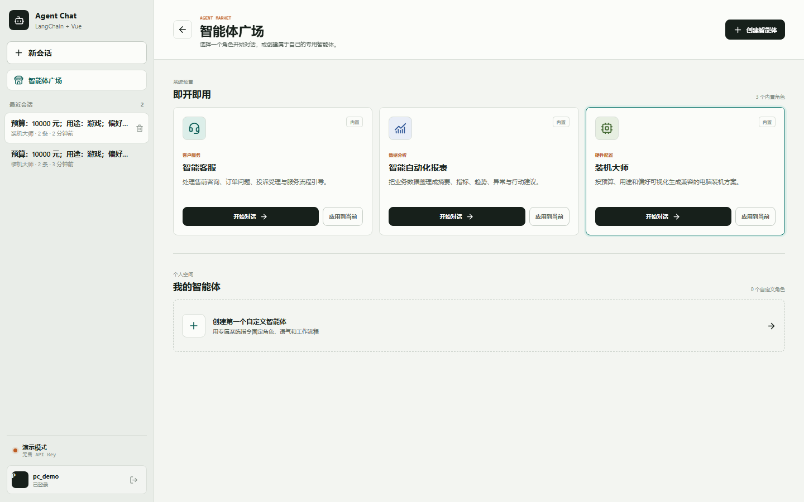
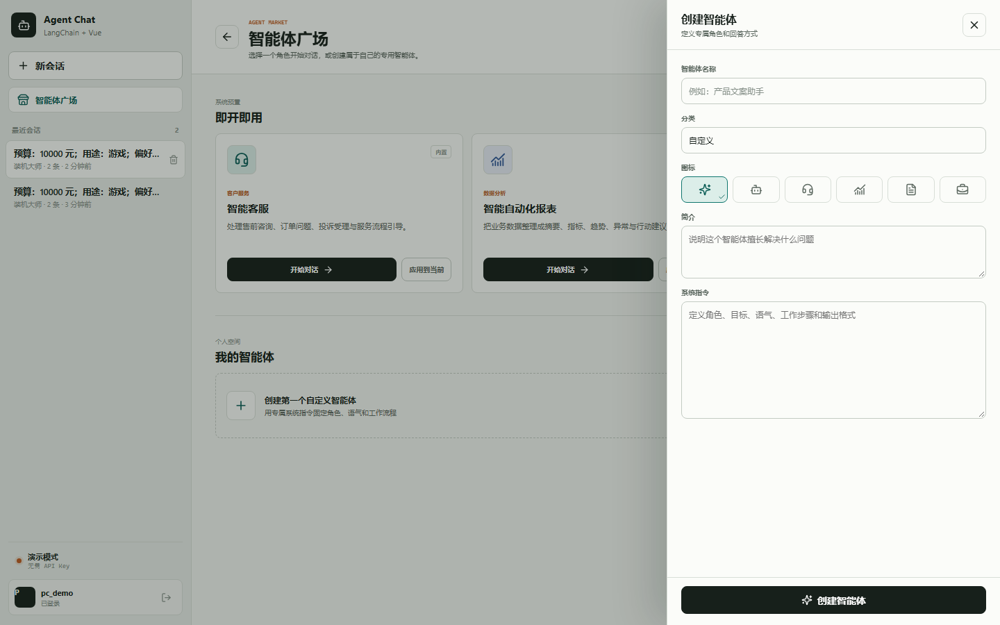
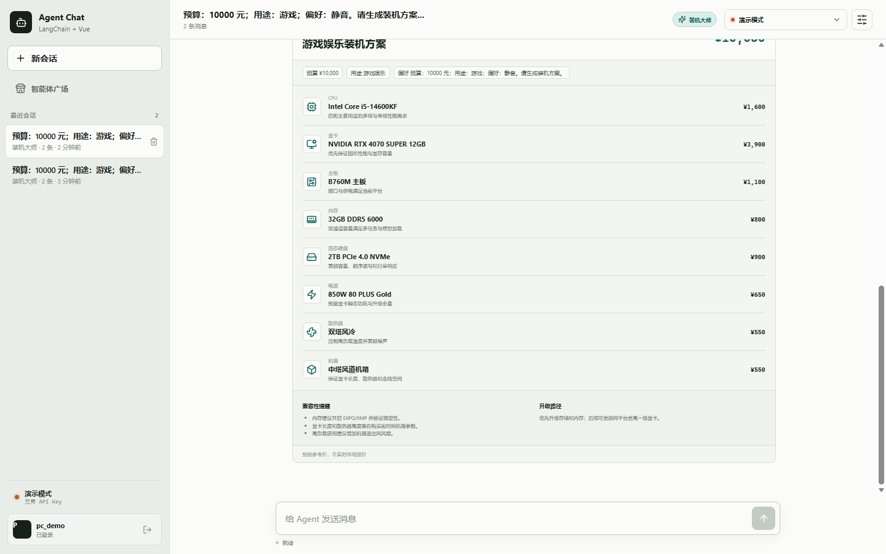
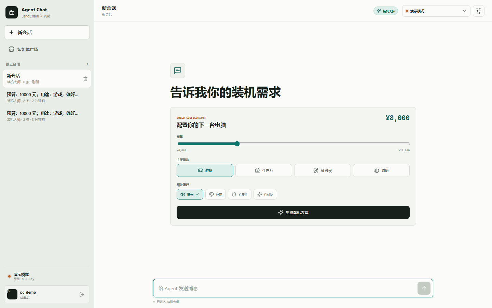
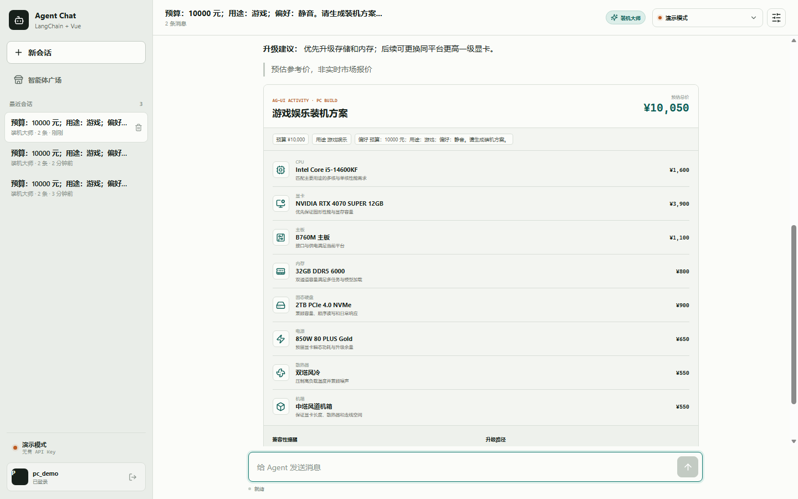
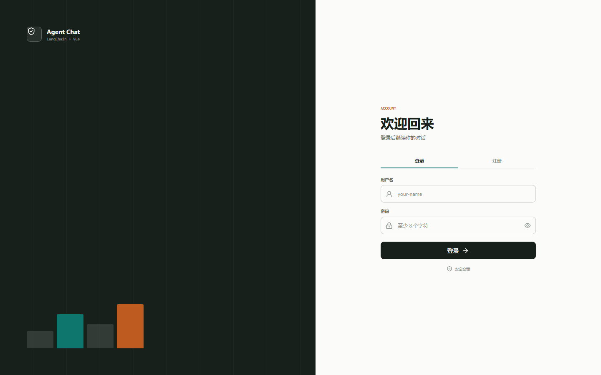
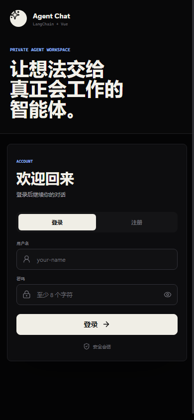
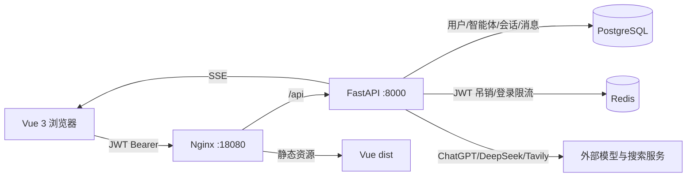

# Agent Chat

一个基于 FastAPI、LangChain 和 Vue 3 的多用户智能体对话应用，包含 JWT 登录、
智能体广场、工具调用、联网搜索、SSE 流式回答以及 PostgreSQL/Redis 持久化。



## 功能说明

### 智能体广场

- 默认内置 **智能客服**、**智能自动化报表** 和 **装机大师**。
- 装机大师使用 AG-UI 活动事件展示可交互装机配置与硬件清单。
- 用户可以创建自己的智能体，配置名称、分类、图标、简介和系统指令。
- 自定义智能体只对创建者可见。
- 可以开始一个新智能体会话，也可以把智能体应用到当前会话。
- 会话会记录使用的智能体；删除智能体后，原会话自动回退为普通助手。

### 多用户认证

- 用户名/密码注册与登录。
- Argon2 密码哈希。
- HS256 JWT Bearer 认证。
- Redis 保存 JWT 登出后的 `jti` 吊销记录。
- Redis 登录失败计数与限流。

### Agent 对话

- LangChain `bind_tools()` 工具调用循环。
- SSE 增量输出和断线重连。
- 工具调用过程可视化。
- 会话历史上下文。
- 用户级数据隔离。

### 模型与联网

- ChatGPT / OpenAI
- DeepSeek
- 自定义 OpenAI 兼容服务
- Tavily 联网搜索
- API Key、API 地址和模型名称可在页面内配置

### 内置工具

- `get_current_time`：获取当前日期、时间和时区
- `calculator`：通过 Python AST 安全计算数学表达式
- `web_search`：通过 Tavily 搜索互联网

## 功能预览

### 创建自定义智能体



### 智能体对话



### 装机大师可视化配置





### 用户登录



### 移动端



## 技术栈

| 模块 | 技术 |
| --- | --- |
| 前端 | Vue 3、TypeScript、Vite、Lucide Icons、MarkdownIt |
| 后端 | Python 3.12、FastAPI、LangChain tool-calling loop |
| 交互协议 | AG-UI 兼容事件子集、SSE、共享状态与活动快照 |
| 模型 | ChatOpenAI、OpenAI/DeepSeek/自定义兼容接口 |
| 搜索 | Tavily API |
| 认证 | PyJWT、Argon2、Redis Token 吊销 |
| 数据库 | PostgreSQL 16、SQLAlchemy Async、asyncpg |
| 缓存 | Redis 7 |
| 部署 | Docker Compose、Nginx |
| 测试 | Pytest、FastAPI TestClient、SQLite/内存替身 |

## 架构



## 快速启动

### 1. 克隆项目

```bash
git clone https://github.com/MingColdMoon/agent-chat.git
cd agent-chat
```

### 2. 可选配置

```bash
cp .env.docker.example .env
```

模型 API Key 也可以登录后在页面设置中填写，`.env` 不是启动必需项。

### 3. Docker 启动

```bash
docker compose up -d --build
```

服务地址：

| 服务 | 地址 |
| --- | --- |
| 前端 | `http://localhost:18080` |
| 后端 API | `http://localhost:8000` |
| PostgreSQL | `localhost:5433` |
| Redis | `localhost:6380` |

首次打开页面后注册账号即可使用。

### 4. 查看状态

```bash
docker compose ps
docker compose logs -f backend
```

### 5. 停止服务

```bash
docker compose down
```

如需同时清除 PostgreSQL 和 Redis 数据：

```bash
docker compose down -v
```

该命令会永久删除本地开发数据。

## 页面内模型配置

登录后点击右上角设置按钮：

1. 选择 `ChatGPT / OpenAI`、`DeepSeek` 或 `自定义兼容服务`。
2. 填写 API Key。
3. 按需修改 API 地址和模型名称。
4. 需要联网时启用 Tavily，并填写 Tavily API Key 和 API 地址。
5. 点击“应用设置”。

默认配置：

| 服务商 | API 地址 | 模型 |
| --- | --- | --- |
| ChatGPT / OpenAI | `https://api.openai.com/v1` | `gpt-4o-mini` |
| DeepSeek | `https://api.deepseek.com/v1` | `deepseek-chat` |
| 自定义 | 手动填写 | 手动填写 |

API Key 只保存在当前标签页的 `sessionStorage`，不会写入 PostgreSQL 对话数据。

## 智能体使用

1. 登录后点击侧边栏“智能体广场”。
2. 选择内置智能体“智能客服”“智能自动化报表”或“装机大师”。
3. 点击“开始对话”创建新会话，或点击“应用到当前”切换当前会话角色。
4. 点击“创建智能体”定义自己的角色和系统指令。
5. 自定义智能体会出现在“我的智能体”区域，仅当前用户可见。

真实模型模式下，智能体系统指令会注入 LangChain `SystemMessage`。演示模式下，
内置智能体会返回对应的客服、报表或装机示例回答，便于无 API Key 验证完整流程。
装机大师通过 AG-UI 的 `STATE_SNAPSHOT` 与 `ACTIVITY_SNAPSHOT` 渲染预算滑杆、
用途选择器、硬件清单和兼容性提示。

## 本地开发

启动基础设施：

```bash
docker compose up -d postgres redis
```

后端：

```bash
cd backend
uv sync --python 3.12
uv run uvicorn app.main:app --reload --port 8000
```

前端：

```bash
cd frontend
npm install
npm run dev
```

Vite 开发地址为 `http://localhost:5173`，`/api` 会代理到后端 `8000`。

## 测试与构建

```bash
cd backend
uv run pytest -q

cd ../frontend
npm run build
```

当前测试覆盖 JWT 认证、Token 吊销、登录限流、用户隔离、消息持久化、SSE、
内置智能体、自定义智能体、权限控制和智能体会话应用。

## 目录

```text
agent-chat/
├── backend/
│   ├── app/
│   │   ├── agent.py       # LangChain Agent 与内置智能体演示
│   │   ├── auth.py        # JWT 与密码哈希
│   │   ├── database.py    # SQLAlchemy 模型和数据库迁移
│   │   ├── main.py        # API、认证依赖与 SSE
│   │   ├── sessions.py    # Redis Token 吊销与登录限流
│   │   ├── storage.py     # 用户、智能体、会话和消息仓储
│   │   └── tools.py       # 时间、计算器和 Tavily
│   ├── tests/
│   └── Dockerfile
├── frontend/
│   ├── src/
│   │   ├── components/
│   │   │   ├── AgentMarketplace.vue
│   │   │   ├── AuthScreen.vue
│   │   │   ├── ChatMessage.vue
│   │   │   ├── ConversationSidebar.vue
│   │   │   ├── PcBuildCard.vue
│   │   │   ├── PcBuilderConfigurator.vue
│   │   │   └── SettingsPanel.vue
│   │   └── ...
│   ├── Dockerfile
│   └── nginx.conf
├── docs/
│   ├── auth-redis-postgresql.md
│   └── images/
├── docker-compose.yml
└── scripts/
```

## 主要 API

| 方法 | 路径 | 用途 |
| --- | --- | --- |
| `POST` | `/api/auth/register` | 注册并获取 JWT |
| `POST` | `/api/auth/login` | 登录 |
| `POST` | `/api/auth/logout` | 登出并吊销 JWT |
| `GET` | `/api/auth/me` | 当前用户 |
| `GET` | `/api/agents` | 内置与个人智能体 |
| `POST` | `/api/agents` | 创建自定义智能体 |
| `DELETE` | `/api/agents/{id}` | 删除自定义智能体 |
| `GET` | `/api/conversations` | 当前用户会话 |
| `POST` | `/api/conversations` | 新建会话，可绑定智能体 |
| `PATCH` | `/api/conversations/{id}/agent` | 给现有会话应用智能体 |
| `POST` | `/api/conversations/{id}/messages` | 启动一轮问答 |
| `GET` | `/api/runs/{id}/events` | SSE 事件流 |

## 数据安全

- `.env`、数据库数据、虚拟环境、`node_modules`、构建产物和本地日志均被忽略。
- 认证使用 JWT Bearer Header，不依赖认证 Cookie。
- JWT 登出后会在 Redis 中记录到原过期时间。
- 用户自定义智能体带所有者约束，其他用户无法读取或应用。
- 会话查询始终同时限制会话 ID 和用户 ID。
- 仓库中不包含真实 API Key、用户密码或生产数据库数据。

## 详细文档

- [智能体广场实现说明](docs/agent-marketplace.md)
- [装机大师与 AG-UI 实现说明](docs/agui-pc-builder.md)
- [JWT 登录、PostgreSQL 与 Redis 实现说明](docs/auth-redis-postgresql.md)

## 生产化建议

- 使用 Alembic 管理数据库迁移。
- 使用强随机 `JWT_SECRET` 并定期轮换。
- 通过 HTTPS 部署。
- 增加 Refresh Token、MFA、审计日志和 IP 级限流。
- 将数据库密码和 API Key 放入 Secret 管理系统。
- 为 SSE Run 状态增加 Redis Streams 或消息队列，以支持多副本恢复。

## License

本项目用于学习与演示，使用者应自行评估模型服务、搜索服务和数据存储的合规要求。

