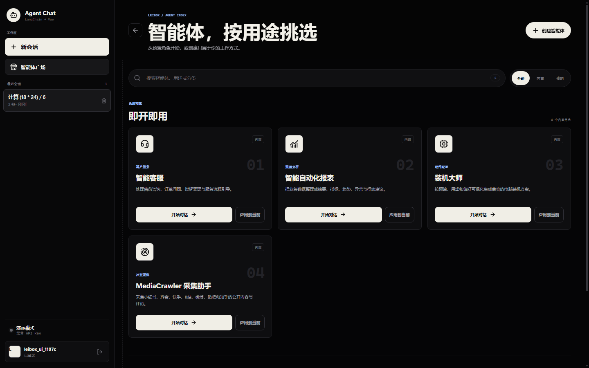
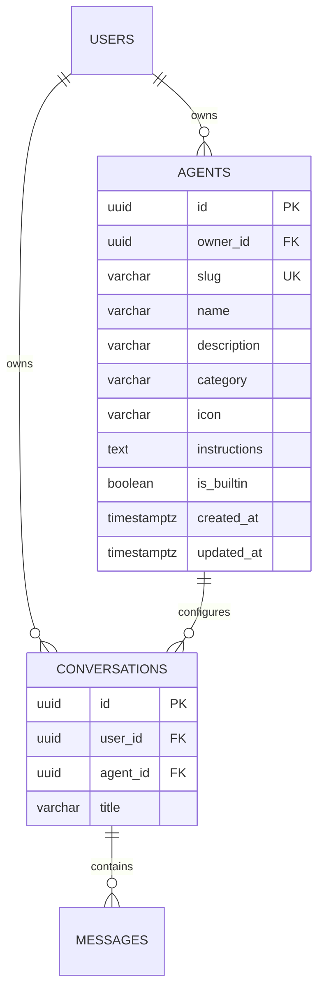
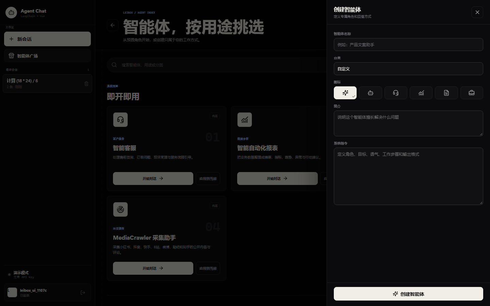

# 智能体广场实现说明

本文记录智能体广场从数据模型、内置智能体、权限隔离到 Vue 页面和真实测试的实现过程。



## 1. 目标

实现以下闭环：

1. 默认内置“智能客服”“智能自动化报表”“装机大师”和
   “MediaCrawler 采集助手”。
2. 用户可以查看并使用所有内置智能体。
3. 用户可以创建自己的智能体。
4. 自定义智能体只对创建者可见。
5. 新会话可以绑定智能体。
6. 现有会话可以切换智能体。
7. 智能体系统指令进入 LangChain 对话上下文。
8. PostgreSQL 持久化智能体和会话归属。

## 2. 数据模型

新增 `agents` 表：



`conversations.agent_id` 可为空：

- 普通会话不绑定智能体。
- 内置和自定义智能体会话保存对应 ID。
- 删除自定义智能体后，外键使用 `ON DELETE SET NULL`，历史会话不会丢失。

### 兼容已有数据库

PostgreSQL 的旧 `conversations` 表不会因为 `create_all` 自动增加字段，因此启动时
执行幂等迁移：

```sql
ALTER TABLE conversations
ADD COLUMN IF NOT EXISTS agent_id UUID
REFERENCES agents(id) ON DELETE SET NULL;
```

实测旧用户 `admin` 和 `user1` 均保留，新增列 `agent_id` 为 nullable。

## 3. 内置智能体种子

内置智能体使用稳定的 UUIDv5，并在每次启动时幂等更新：

| 名称 | slug | 分类 | 图标 |
| --- | --- | --- | --- |
| 智能客服 | `customer-service` | 客户服务 | headset |
| 智能自动化报表 | `automated-reports` | 数据分析 | chart |
| 装机大师 | `pc-builder` | 硬件配置 | cpu |
| MediaCrawler 采集助手 | `media-crawler` | 社交媒体 | radar |

种子代码位于 `backend/app/storage.py`：

```python
BUILTIN_AGENTS = (
    {
        "slug": "customer-service",
        "name": "智能客服",
        "instructions": "你是专业、耐心的中文智能客服...",
    },
    {
        "slug": "automated-reports",
        "name": "智能自动化报表",
        "instructions": "你是自动化报表分析助手...",
    },
    {
        "slug": "pc-builder",
        "name": "装机大师",
        "instructions": "你是装机大师，根据预算和用途生成装机方案...",
    },
    {
        "slug": "media-crawler",
        "name": "MediaCrawler 采集助手",
        "instructions": "你是 MediaCrawler 社交媒体数据采集助手...",
    },
)
```

应用启动时调用 `agent_store.seed_builtins()`。如果记录已存在则更新文案和指令，
不存在则插入，因此重复启动不会产生重复智能体。

## 4. 权限设计

可访问条件：

```python
or_(
    AgentRecord.is_builtin.is_(True),
    AgentRecord.owner_id == current_user_id,
)
```

这意味着：

- 内置智能体对所有登录用户可见。
- 自定义智能体仅创建者可见。
- 其他用户不能把该智能体绑定到自己的会话。
- 内置智能体不可删除。

## 5. Agent API

| 方法 | 路径 | 作用 |
| --- | --- | --- |
| `GET` | `/api/agents` | 内置 + 当前用户智能体 |
| `POST` | `/api/agents` | 创建自定义智能体 |
| `DELETE` | `/api/agents/{id}` | 删除自己的智能体 |
| `POST` | `/api/conversations` | 新建会话并绑定 `agent_id` |
| `PATCH` | `/api/conversations/{id}/agent` | 给现有会话应用智能体 |

创建请求示例：

```json
{
  "name": "产品文案助手",
  "description": "为产品生成有行动感的营销文案。",
  "category": "内容创作",
  "icon": "sparkles",
  "instructions": "先识别目标用户和核心卖点，再给出三个不同风格的文案方案。"
}
```

## 6. 注入 LangChain

创建会话时保存 `agent_id`。发送消息时读取会话绑定的系统指令，并注入：

```python
messages = [
    SystemMessage(content=_compose_system_prompt(agent_prompt)),
    *_to_langchain_messages(history),
]
```

基础系统提示词继续负责安全、工具使用和语言规则，智能体指令只追加角色配置。

演示模式也有独立行为：

- 智能客服会引导用户提供订单号、问题类型等信息。
- 智能自动化报表会生成包含摘要、指标、异常和建议的 Markdown 报表模板。
- 装机大师会生成 AG-UI 可视化装机配置器与硬件活动卡片。
- MediaCrawler 采集助手会生成结构化采集任务预览或真实任务活动卡片。
- 自定义智能体会显示当前角色名称。

## 7. Vue 页面

页面组件：`frontend/src/components/AgentMarketplace.vue`

功能：

- 侧边栏入口“智能体广场”。
- 内置智能体区域。
- 我的智能体区域。
- 按名称、简介和分类搜索。
- “全部 / 内置 / 我的”筛选。
- 开始新会话。
- 应用到当前会话。
- 删除自定义智能体。
- 创建智能体抽屉。

### 广场截图


### 创建智能体



表单验证：

- 名称至少 2 个字符。
- 描述至少 4 个字符。
- 系统指令至少 10 个字符。
- 图标从预设图标中选择。

## 8. 实测 API 结果

```json
{
  "Builtins": "智能客服,智能自动化报表,装机大师,MediaCrawler 采集助手",
  "Custom": "产品文案助手",
  "ConversationAgent": "智能客服",
  "CustomerReply": true,
  "AppliedAgent": "产品文案助手",
  "Jwt": "bearer"
}
```

这验证了：

1. 四个内置智能体默认存在。
2. 用户可以创建自定义智能体。
3. 新会话可以绑定智能客服。
4. 智能客服演示回答进入 SSE。
5. 现有会话可以切换为自定义智能体。
6. 所有接口继续使用 JWT Bearer 认证。

## 9. 自动化测试

执行：

```bash
cd backend
uv run pytest -q
```

结果：

```text
............... [100%]
16 passed
```

新增覆盖：

- 三个内置智能体默认存在。
- 自定义智能体创建、使用和删除。
- 自定义智能体对其他用户不可见。
- 其他用户不能使用不属于自己的智能体。
- 智能体可应用到已有会话。
- 删除智能体后会话回退为普通助手。
- 智能客服演示模式具有客服角色行为。

## 10. 注意事项

- 当前采用启动时幂等迁移，生产环境建议改用 Alembic。
- 智能体系统指令属于用户输入，应限制长度并记录审计信息。
- 若未来支持公开广场，需要增加发布、审核、举报和可见性字段。
- 当前自定义智能体为个人私有，不跨用户共享。

