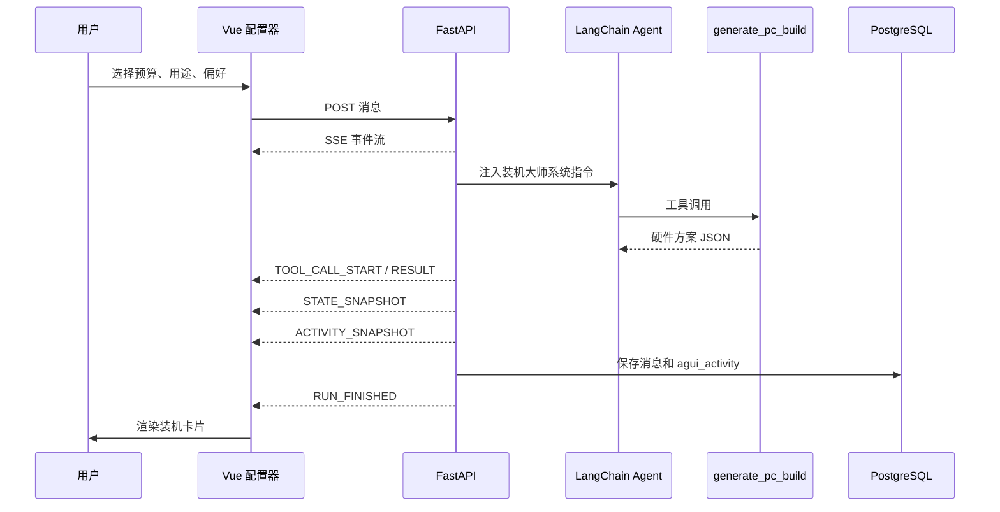
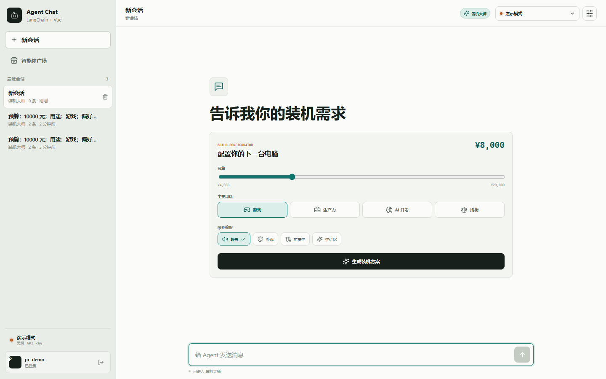
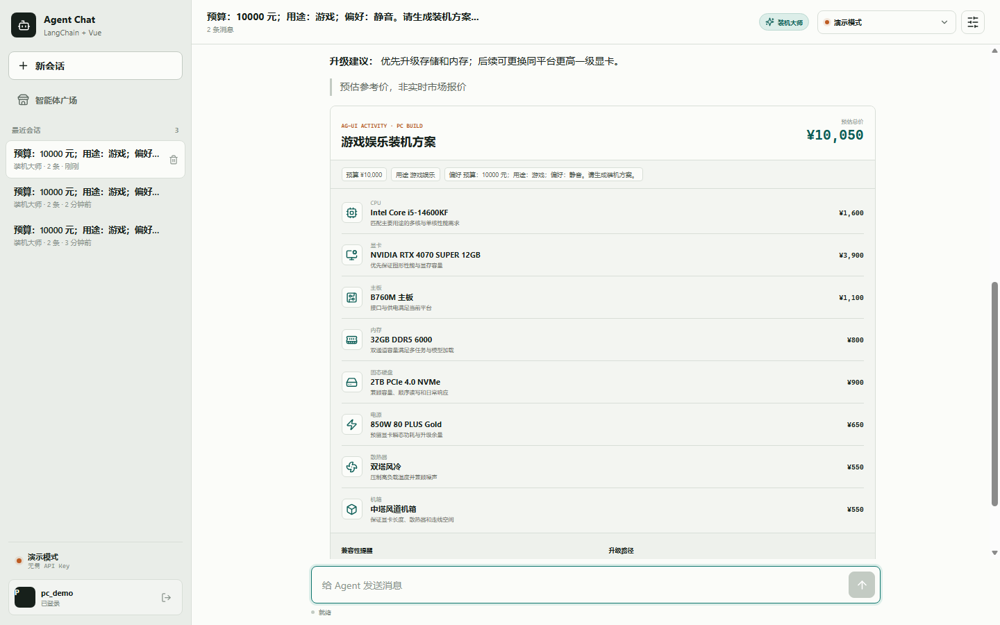

# 装机大师与 AG-UI 可视化实现

本文记录“装机大师”智能体的设计、实现和验证过程。该智能体使用 AG-UI 兼容事件
子集，把 Agent 的工具结果转换为前端可渲染、可持久化的装机活动。

## 1. 目标

1. 在智能体广场增加内置“装机大师”。
2. 用户通过预算滑杆、用途和偏好进行可视化操作。
3. Agent 调用装机工具生成兼容的硬件组合。
4. 使用 AG-UI 事件传递共享状态和活动快照。
5. 将装机活动持久化，刷新会话后仍能看到硬件清单。
6. 不把预估价格展示为实时市场报价。

## 2. 总体流程



## 3. 内置智能体

`backend/app/storage.py` 中的种子数据新增：

```python
{
    "slug": "pc-builder",
    "name": "装机大师",
    "description": "按预算、用途和偏好可视化生成兼容的电脑装机方案。",
    "category": "硬件配置",
    "icon": "cpu",
    "instructions": (
        "你是装机大师。根据用户的预算、主要用途、性能偏好和外观偏好，"
        "调用 generate_pc_build 工具生成配置..."
    ),
}
```

内置智能体在启动时幂等写入，所以重复启动不会生成重复记录。

## 4. 装机工具

工具定义位于 `backend/app/tools.py`：

```python
@tool
def generate_pc_build(
    budget: int,
    use_case: str,
    priorities: str = "",
) -> dict[str, Any]:
    ...
```

### 配置策略

预算会限制在 `4000-30000` 元范围。不同用途使用不同 CPU/GPU 预算比例：

| 用途 | CPU 比例 | GPU 比例 | 重点 |
| --- | ---: | ---: | --- |
| 游戏 | 16% | 39% | 游戏帧率与显卡 |
| 生产力 | 25% | 22% | 多核性能 |
| AI 开发 | 16% | 43% | 显存容量 |
| 均衡 | 20% | 31% | 综合性能 |

输出包含 8 类硬件：

- CPU
- 显卡
- 主板
- 内存
- 固态硬盘
- 电源
- 散热器
- 机箱

每项包含分类、型号、预估价格和选择理由。结果还包含预算差额、兼容性提醒、
升级路径和价格说明。

工具仅在 `agent_key == "pc-builder"` 时加入 LangChain 工具列表：

```python
if agent_key == "pc-builder":
    tools.append(generate_pc_build)
```

## 5. AG-UI 事件

本实现使用 AG-UI 规范中的标准事件名和核心字段，并通过现有 SSE 传输。

| AG-UI 事件 | 用途 |
| --- | --- |
| `RUN_STARTED` | 一轮 Agent 运行开始 |
| `TEXT_MESSAGE_START` | 创建助手文本消息 |
| `TEXT_MESSAGE_CONTENT` | 文本增量 |
| `TEXT_MESSAGE_END` | 文本结束 |
| `TOOL_CALL_START` | 工具调用开始 |
| `TOOL_CALL_END` | 工具调用结束 |
| `TOOL_CALL_RESULT` | 工具结果 |
| `STATE_SNAPSHOT` | 共享装机状态快照 |
| `ACTIVITY_SNAPSHOT` | 可视化活动快照 |
| `RUN_FINISHED` | 运行完成 |
| `RUN_ERROR` | 运行失败 |

### STATE_SNAPSHOT

```json
{
  "type": "STATE_SNAPSHOT",
  "snapshot": {
    "pcBuild": {
      "title": "游戏娱乐装机方案",
      "budget": 10000,
      "total_price": 10050,
      "components": []
    }
  }
}
```

### ACTIVITY_SNAPSHOT

```json
{
  "type": "ACTIVITY_SNAPSHOT",
  "messageId": "assistant-message-uuid",
  "activityType": "pc-build-plan",
  "content": {
    "title": "游戏娱乐装机方案",
    "components": []
  },
  "replace": true
}
```

前端识别 `activityType === "pc-build-plan"` 后渲染装机卡片。

## 6. 前端可视化操作

### 配置器

组件：`frontend/src/components/PcBuilderConfigurator.vue`

用户可以操作：

- 预算滑杆：`¥4,000 - ¥20,000`
- 用途：游戏、生产力、AI 开发、均衡
- 偏好：静音、外观、扩展性、性价比

点击“生成装机方案”后，前端组合为：

```text
预算：10000 元；用途：游戏；偏好：静音、外观。请生成装机方案。
```

### 装机结果卡片

组件：`frontend/src/components/PcBuildCard.vue`

展示：

- 方案名称和预估总价
- 预算、用途和偏好标签
- 8 类硬件与每项预估价格
- 选择理由
- 兼容性提醒
- 升级路径
- 预估价格声明

### 配置页面



### AG-UI 方案卡片



## 7. 数据持久化

PostgreSQL `messages` 表新增：

```sql
ALTER TABLE messages
ADD COLUMN IF NOT EXISTS agui_activity JSONB;
```

Pydantic 消息模型增加：

```python
activity: dict[str, Any] | None = None
```

`ACTIVITY_SNAPSHOT` 到达时前端立即更新流式消息；最终消息落库后，
`agui_activity` 随之保存。重新打开历史会话时仍会渲染装机卡片。

## 8. 实测结果

接口实测：

```json
{
  "Agent": "装机大师",
  "AguiEvents": "RUN_STARTED,TEXT_MESSAGE_CONTENT,TOOL_CALL_START,STATE_SNAPSHOT,ACTIVITY_SNAPSHOT,RUN_FINISHED",
  "ActivityType": "pc-build-plan",
  "UseCase": "游戏娱乐",
  "Components": 8,
  "Total": 10050
}
```

数据库迁移实测：

```text
column_name    | data_type | is_nullable
agui_activity  | jsonb     | YES
```

## 9. 自动化测试

```bash
cd backend
uv run pytest -q
```

结果：

```text
................ [100%]
16 passed
```

新增测试验证：

- 装机大师默认存在。
- AG-UI 运行、消息、工具、状态、活动和完成事件均存在。
- 装机方案包含 8 类组件。
- `agui_activity` 成功写入会话消息。
- 历史消息可以读取活动快照。

## 10. 扩展建议

- 接入实时硬件价格 API，替换预估价格。
- 使用 AG-UI `STATE_DELTA` 支持保守修改预算后的增量更新。
- 增加组件替换、锁定某品牌、功耗计算和兼容性实时校验。
- 为前端活动注册组件白名单，避免任意 activityType 渲染。
- 生产环境通过正式 AG-UI SDK 校验事件契约。

