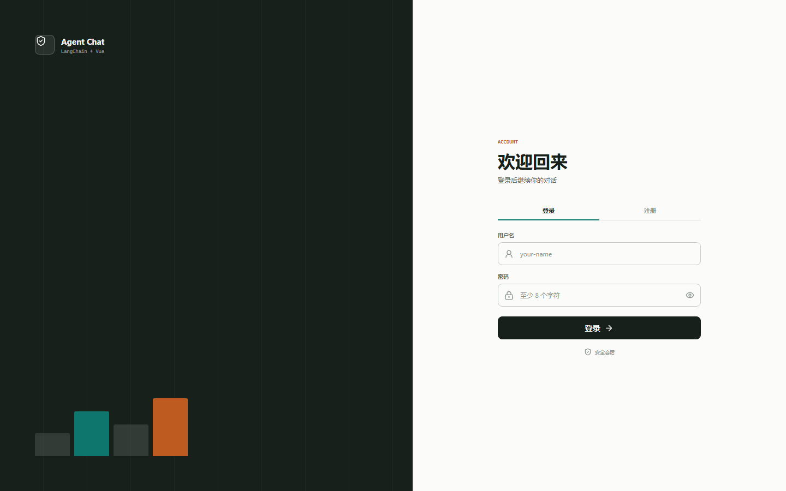
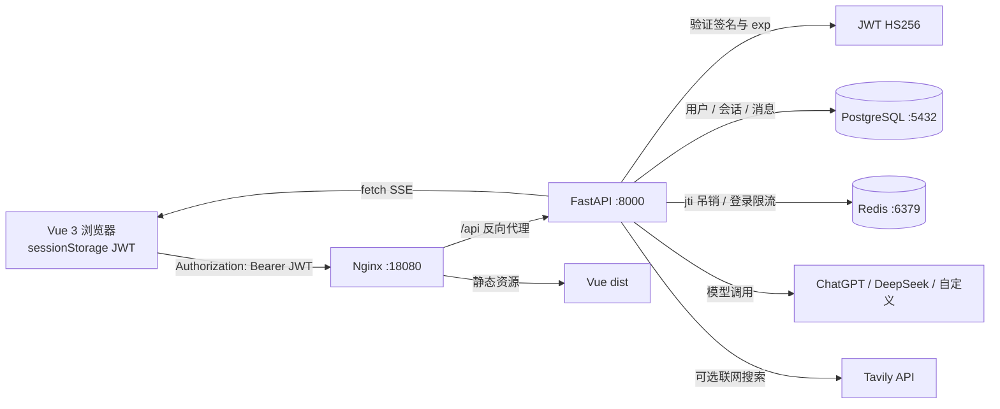
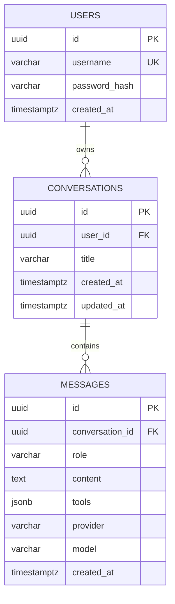
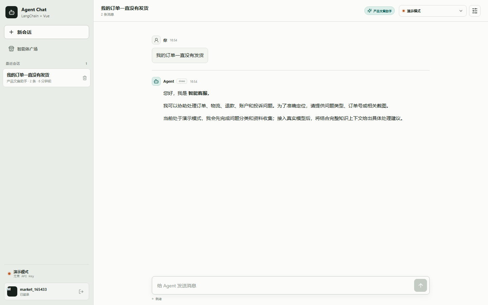
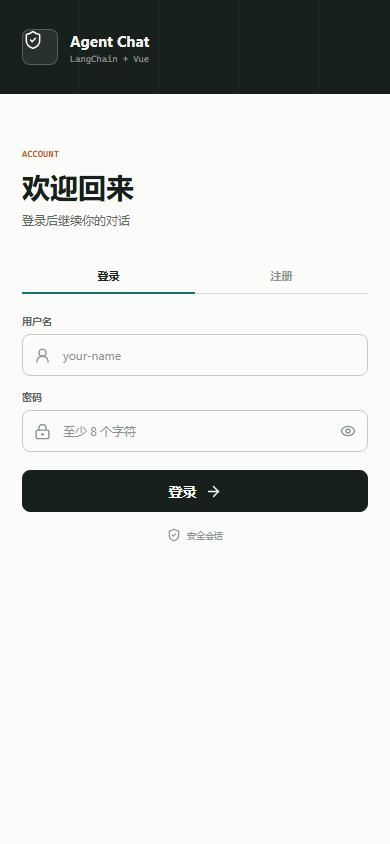

# JWT 登录、PostgreSQL 与 Redis 实现说明

本文记录 Agent Chat 从 Cookie 会话升级为 JWT Bearer 认证的完整过程，
包括每一步的目标、关键代码、执行命令、实际测试结果和界面截图。

## 1. 最终结果

本次实现完成了：

1. 用户名/密码注册、登录和登出。
2. Argon2 密码哈希，数据库不保存明文密码。
3. HS256 JWT Access Token，默认有效期 60 分钟。
4. JWT 保存在当前标签页的 `sessionStorage`。
5. 所有受保护 API 使用 `Authorization: Bearer <token>`。
6. Redis 保存登出后的 JWT `jti` 吊销记录。
7. Redis 登录失败计数与限流。
8. PostgreSQL 保存用户、会话、消息和工具轨迹。
9. 用户只能读取自己的会话，跨用户访问返回 404。
10. SSE 改为 `fetch + ReadableStream`，从而可以发送 Bearer Header。
11. Docker Compose 编排 PostgreSQL、Redis、FastAPI 和 Vue/Nginx。
12. 自动化测试与真实 Docker 请求验证。



## 2. 总体架构



关键变化：

- 不再设置或读取认证 Cookie。
- JWT 不存入 PostgreSQL。
- Redis 不再保存登录 Session，只保存 Token 吊销记录和登录失败计数。
- 浏览器刷新当前标签页后可以从 `sessionStorage` 恢复 JWT。
- 关闭标签页后 `sessionStorage` 自动清除。

## 3. 为什么 SSE 改成 fetch

浏览器原生 `EventSource` 不能自定义 `Authorization` Header。为了避免把 JWT
放入 URL（可能进入日志、代理缓存和历史记录），前端改用：

```ts
const response = await fetch(streamUrl, {
  headers: {
    Accept: 'text/event-stream',
    Authorization: `Bearer ${accessToken}`,
  },
  signal,
})
```

然后逐块读取 `response.body`，解析 `data:` 行。客户端同时记录 SSE `id`，连接中断
后重新请求并携带 `Last-Event-ID`，实现断线补发。

## 4. 第一步：JWT 配置与签发

### 想解决的问题

用签名 Token 代替服务端 Session，让认证状态可以自校验，同时保留主动注销能力。

### 配置

`backend/app/config.py`：

```python
jwt_secret: str = "local-dev-jwt-secret-change-before-production"
jwt_algorithm: str = "HS256"
jwt_issuer: str = "agent-chat"
jwt_expiration_minutes: int = Field(default=60, ge=5, le=1440)
```

Docker Compose 通过环境变量覆盖：

```yaml
JWT_SECRET: ${JWT_SECRET:-local-dev-jwt-secret-change-before-production}
JWT_ALGORITHM: HS256
JWT_ISSUER: agent-chat
JWT_EXPIRATION_MINUTES: 60
```

生产环境必须替换 `JWT_SECRET`，建议使用至少 32 字节的随机值。

### 签发代码

`backend/app/auth.py`：

```python
def create_access_token(user: UserRecord, settings: Settings):
    now = datetime.now(UTC)
    expires_at = now + timedelta(minutes=settings.jwt_expiration_minutes)
    jti = secrets.token_urlsafe(24)
    payload = {
        "sub": str(user.id),
        "username": user.username,
        "type": "access",
        "jti": jti,
        "iss": settings.jwt_issuer,
        "iat": int(now.timestamp()),
        "exp": int(expires_at.timestamp()),
    }
    token = jwt.encode(
        payload,
        settings.jwt_secret,
        algorithm=settings.jwt_algorithm,
    )
    return token, expires_at, jti
```

### JWT Payload

| 字段 | 含义 |
| --- | --- |
| `sub` | 用户 UUID |
| `username` | 用户名 |
| `type` | 固定为 `access` |
| `jti` | Token 唯一 ID，用于注销吊销 |
| `iss` | 签发者 |
| `iat` | 签发时间 |
| `exp` | 到期时间 |

### API 返回

注册和登录返回：

```json
{
  "access_token": "eyJ...",
  "token_type": "bearer",
  "expires_in": 3600,
  "expires_at": "2026-11-01T11:00:00Z",
  "user": {
    "id": "uuid",
    "username": "alice"
  }
}
```

服务端不设置 `Set-Cookie`。

## 5. 第二步：Bearer 认证依赖

### 实现目标

每个受保护路由从 `Authorization` 读取 JWT，验证：

1. Header 格式是否为 `Bearer <token>`。
2. HS256 签名是否正确。
3. `iss` 和 `type` 是否正确。
4. `exp` 是否未过期。
5. `jti` 是否已在 Redis 中注销。
6. `sub` 对应的用户是否仍存在。

### 关键代码

```python
authorization = request.headers.get("authorization", "")
scheme, _, token = authorization.partition(" ")
if scheme.lower() != "bearer" or not token:
    raise HTTPException(status_code=401, detail="缺少 Bearer JWT")

payload = decode_access_token(token, settings)
if await session_store.is_token_revoked(payload["jti"]):
    raise HTTPException(status_code=401, detail="JWT 已注销")

user = await user_store.by_id(payload["sub"])
```

普通 API 和 SSE 都调用同一个认证依赖。

## 6. 第三步：前端 Token 存储与请求

### Token 存储

`frontend/src/api.ts` 使用当前标签页的 `sessionStorage`：

```ts
const TOKEN_STORAGE_KEY = 'agent-chat-access-token'

function setAccessToken(token: string) {
  window.sessionStorage.setItem(TOKEN_STORAGE_KEY, token)
}
```

选择 `sessionStorage` 的原因：

- 刷新当前标签页仍保持登录。
- 关闭标签页后自动清除。
- 不与其它标签页自动共享。
- 不写入 Cookie，不触发跨站自动携带。

### 请求头

```ts
const headers = new Headers(options?.headers)
if (accessToken) {
  headers.set('Authorization', `Bearer ${accessToken}`)
}
```

遇到 401 时，前端清除本地 JWT 并回到登录页。

## 7. 第四步：Redis Token 吊销

JWT 默认无状态，但登出后需要立即失效，因此使用 Redis 黑名单。

### Redis 键

| 键 | 值 | TTL |
| --- | --- | --- |
| `auth:revoked:<jti>` | `1` | JWT 剩余有效期 |
| `auth:fail:<sha256(ip:username)>` | 失败次数 | 10 分钟 |

### 注销代码

```python
async def logout(auth: CurrentAuth) -> None:
    expires_at = int(auth.payload["exp"])
    ttl = max(1, expires_at - int(datetime.now(UTC).timestamp()))
    await session_store.revoke_token(
        str(auth.payload["jti"]),
        ttl,
    )
```

Redis 只保留到 JWT 原本过期的时间，避免黑名单无限增长。

### 实测 Redis 输出

```text
auth:revoked:5UT-Gh7bpslZtn2ThomBkz3DsyjdPMnb
```

同时确认没有 Cookie Session 键 `auth:session:*`。

## 8. 第五步：密码与用户数据

### 密码哈希

使用 `pwdlib` 推荐的 Argon2：

```python
password_hash = PasswordHash.recommended()

async def hash_password(password: str) -> str:
    return await run_in_threadpool(password_hash.hash, password)
```

数据库中只保存 Argon2 哈希。

### PostgreSQL 模型



所有会话读取都同时限制 `conversation_id` 和 `user_id`：

```python
conversation = await session.scalar(
    select(ConversationRecord).where(
        ConversationRecord.id == conversation_uuid,
        ConversationRecord.user_id == user_uuid,
    )
)
```

## 9. 第六步：Docker Compose

### 服务组成

| 服务 | 镜像/构建 | 本机端口 | 作用 |
| --- | --- | --- | --- |
| `postgres` | `postgres:16-alpine` | `5433 -> 5432` | 用户与会话持久化 |
| `redis` | `redis:7-alpine` | `6380 -> 6379` | JWT 吊销和登录限流 |
| `backend` | `backend/Dockerfile` | `8000 -> 8000` | FastAPI、JWT、SSE |
| `frontend` | `frontend/Dockerfile` | `18080 -> 80` | Vue 与 API 代理 |

本机 `8080` 已被其它进程占用，因此前端使用 `18080`。

### 启动

```powershell
cd agent-chat
docker compose up -d --build
```

### Nginx SSE

```nginx
location /api/ {
    proxy_pass http://backend:8000;
    proxy_http_version 1.1;
    proxy_buffering off;
    proxy_cache off;
    proxy_read_timeout 3600s;
    add_header X-Accel-Buffering no;
}
```

### 实际容器状态

```text
agent-chat-backend-1   Up (healthy)   0.0.0.0:8000->8000/tcp
agent-chat-frontend-1  Up             0.0.0.0:18080->80/tcp
agent-chat-postgres-1  Up (healthy)   0.0.0.0:5433->5432/tcp
agent-chat-redis-1     Up (healthy)   0.0.0.0:6380->6379/tcp
```

## 10. 测试与实测结果

### 自动化测试

```powershell
cd backend
uv run pytest -q
```

```text
...........                                                              [100%]
11 passed
```

覆盖：

- 无 Bearer JWT 返回 401。
- JWT 被篡改返回 401。
- 登出后同一 JWT 返回 401。
- 登录限流返回 429。
- 用户 A 无法读取用户 B 的会话。
- PostgreSQL 会话与消息持久化。
- 应用重启后登录仍能看到历史会话。
- SSE 使用 Bearer JWT 完成。
- Tavily 工具创建和结果格式化。

### 真实 JWT 请求

实测注册响应：

```json
{
  "JwtSegments": 3,
  "TokenType": "bearer",
  "ExpiresIn": 3600,
  "SetCookiePresent": false
}
```

实测对话：

```json
{
  "MessageCount": 2,
  "Assistant": "`21 * 2` 的计算结果是 **42**。",
  "SseDone": true,
  "LogoutStatus": 204,
  "PostLogoutStatus": 401
}
```

PostgreSQL 结果：

```text
   username   | conversations | messages
--------------+---------------+----------
 jwt_104754   |             1 |        2
```

### 对话界面



### 手机登录页面



## 11. 常用命令

启动全部服务：

```powershell
docker compose up -d
```

重新构建：

```powershell
docker compose up -d --build
```

查看状态：

```powershell
docker compose ps
```

查看日志：

```powershell
docker compose logs -f backend
docker compose logs -f frontend
```

停止并保留数据：

```powershell
docker compose down
```

停止并删除数据卷：

```powershell
docker compose down -v
```

最后一条命令会永久删除 PostgreSQL 和 Redis 数据。

## 12. 生产化建议

1. 使用强随机 `JWT_SECRET`，不要使用仓库中的本地默认值。
2. 缩短 Access Token 有效期，并增加 Refresh Token 轮换。
3. 使用 Alembic 管理 PostgreSQL 迁移。
4. 对注册和登录增加 IP 级限流、MFA 或验证码。
5. 为 JWT 增加自定义受众 `aud` 与密钥轮换机制。
6. 将 PostgreSQL/Redis 密码放在 Secret 管理系统。
7. 对高风险操作增加二次认证和审计日志。
8. 多副本部署时把 SSE Run 状态迁移到 Redis Streams 或消息队列。

