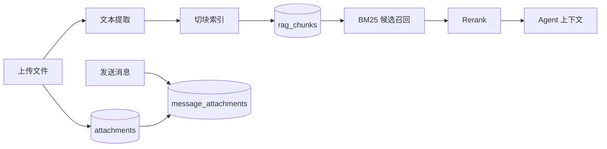
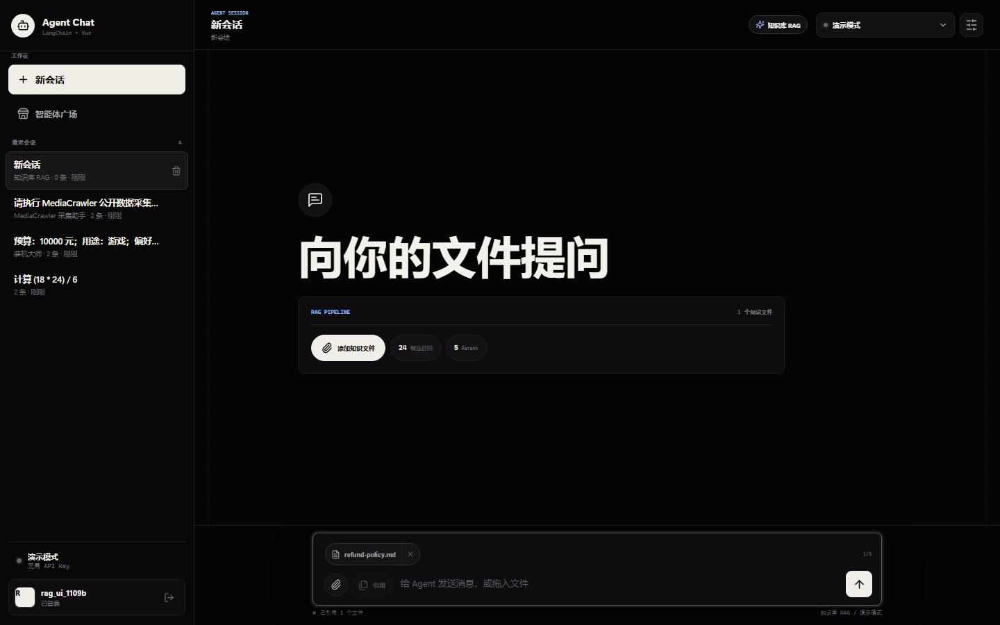
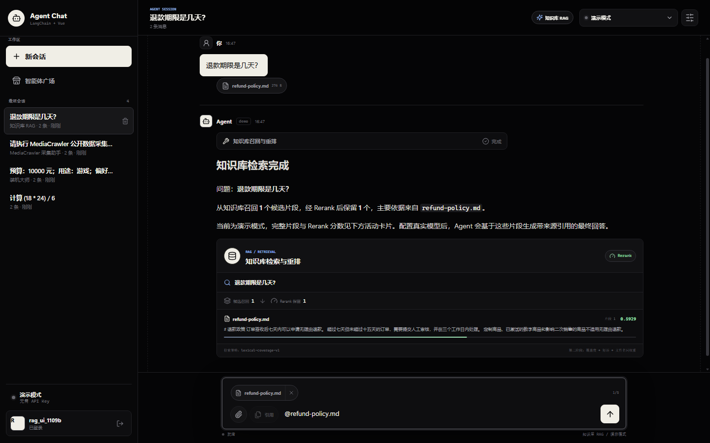

# 文件引用与知识库 RAG

对话框支持上传文件、把文件绑定到消息，并在后续消息中重复引用同一份文件。
“知识库 RAG”内置智能体会把上传文件转换为可检索片段，并在每次提问时执行
候选召回和第二阶段 Rerank。

## 文件生命周期

- 文件按用户与会话隔离，下载接口要求 JWT。
- 同一附件可以关联到多条消息，后续消息不需要重复上传。
- 单文件上限 15 MB，每条消息最多引用 5 个文件。
- 未绑定到消息的临时附件会在 24 小时后清理。
- 删除会话会同时清理数据库记录和物理文件。

Docker Compose 使用 `uploads_data` 卷挂载到 `/app/data`，容器重建后上传文件仍然存在。

## 支持格式

| 类型 | 处理方式 |
| --- | --- |
| TXT / Markdown / CSV / JSON / 代码 / 配置 | 直接解码并按文本索引 |
| PDF | 使用 `pypdf` 提取前 80 页文本 |
| DOCX | 读取 `word/document.xml` |
| 图片 | 保留可下载引用和文件元数据，不执行 OCR |
| 其他可解码文本 | 尝试 UTF-8、UTF-16、GB18030、Big5 与 Latin-1 |

可执行文件扩展名会被拒绝。上传文件始终使用 UUID 文件名保存，不执行其中的代码。

## 文档切块

- 目标块大小约 900 字符。
- 相邻块重叠约 120 字符。
- 优先在段落、换行或句号处断开。
- 单文件最多保留 160,000 字符进入索引；普通附件注入模型上下文时会进一步限制总量。

## 召回与 Rerank

当前 RAG 使用本地可解释检索，不依赖额外向量数据库：

1. 中文按完整短语与双字组合切词，英文按单词切词。
2. 使用 BM25 在当前会话的 `rag_chunks` 中召回最多 24 个候选。
3. 第二阶段执行 `lexical-coverage-v1` Rerank：
   - 55% 归一化 BM25 分数
   - 30% 查询词覆盖度
   - 10% 完整短语命中
   - 5% 文件名匹配
4. 按重排分数保留最多 5 个片段，与来源文件名一起注入 Agent 系统上下文。

这是本地词法重排，不会把分数描述成神经 Cross-Encoder 或模型置信度。
后续可以在 `RagStore.search()` 外部替换为向量召回或 Cross-Encoder Rerank，
消息协议和活动卡片无需改变。

## 界面

输入框支持文件选择和拖拽上传。文件芯片可以移除；选择“引用”可从当前会话
历史文件中再次添加引用，同时把 `@文件名` 插入消息。

## 测试覆盖

- 文本文件上传、内容提取与鉴权下载。
- 附件绑定消息与持久化回放。
- 同一文件在多轮消息中重复引用。
- 未绑定附件删除。
- RAG 召回、`lexical-coverage-v1` Rerank 与 AG-UI 活动快照。
