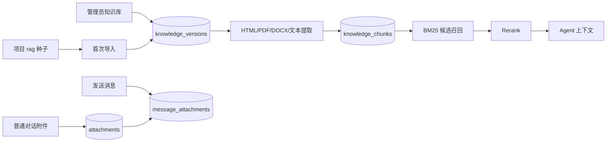
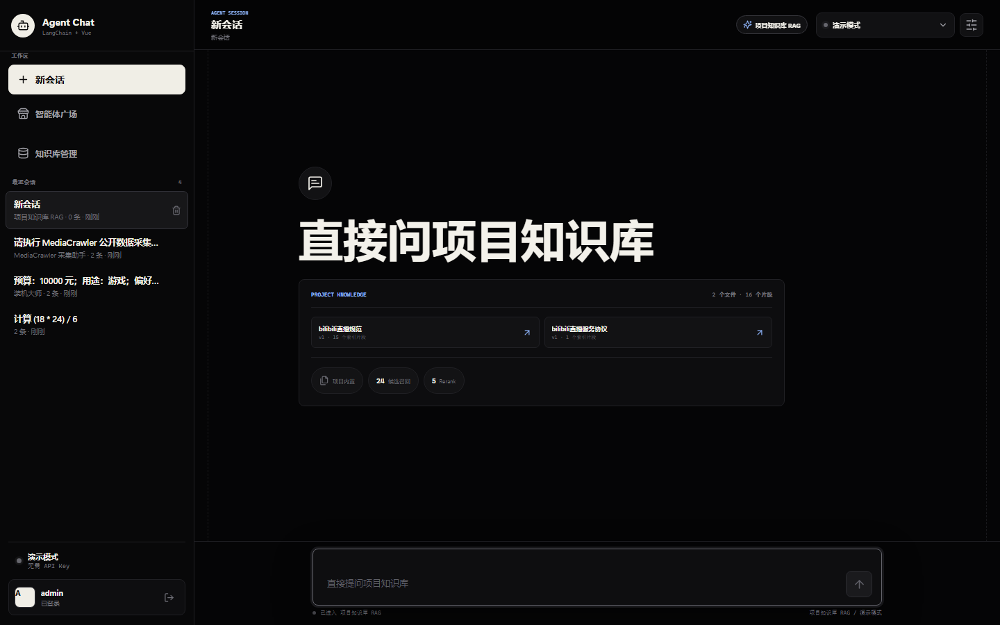
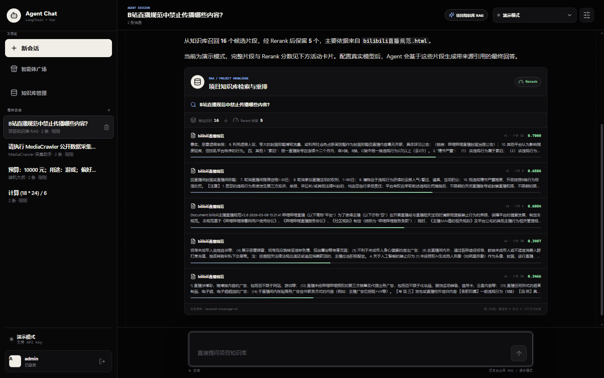
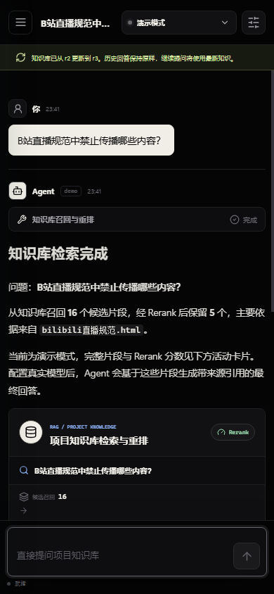
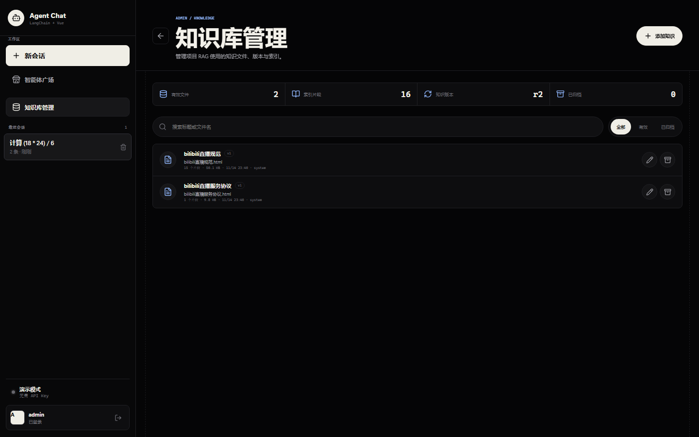
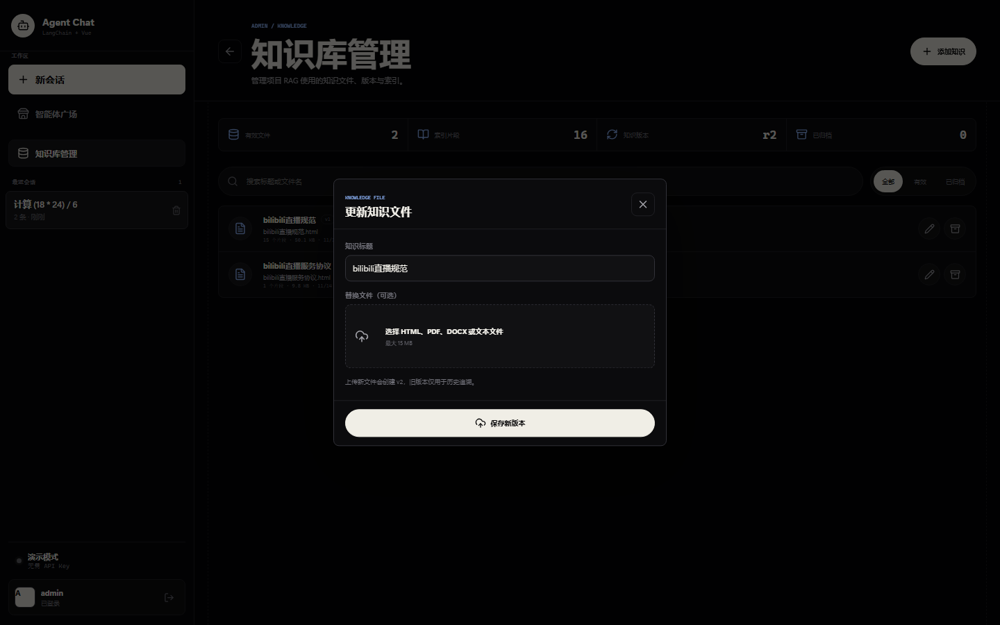

# 文件引用与项目知识库 RAG

对话框支持上传文件、把文件绑定到消息，并在后续消息中重复引用同一份文件。
“项目知识库 RAG”内置智能体使用管理员维护的版本化知识库，用户无需上传文件
即可直接提问。项目根目录的 `rag/` 只作为首次启动时的导入种子。

## 文件生命周期

普通对话附件按用户与会话隔离，下载接口要求 JWT。同一附件可以关联到多条
消息，单文件上限 15 MB，每条消息最多引用 5 个文件。未绑定附件会在 24 小时后
清理，删除会话时同步清理物理文件。

项目知识库不依赖用户上传：

- 首次启动时把 `rag/` 中支持的文件导入管理库。
- 之后仅管理员可以添加、改标题、替换新版本或归档文件。
- 文档采用不可变版本；归档不会物理删除历史版本和 chunk。
- 管理员变更会递增全局 knowledge revision。
- Docker Compose 将 `./rag` 只读挂载到 `/app/rag` 作为种子，并将可写知识文件
  保存在 `/app/data/knowledge`。

## 支持格式

| 类型 | 处理方式 |
| --- | --- |
| TXT / Markdown / CSV / JSON / 代码 / 配置 | 直接解码并按文本索引 |
| PDF | 使用 `pypdf` 提取前 80 页文本 |
| DOCX | 读取 `word/document.xml` |
| HTML / HTM | 移除脚本、样式、SVG 和导航标签后提取可读正文 |
| 图片 | 普通附件保留可下载引用和文件元数据，不执行 OCR |
| 其他可解码文本 | 尝试 UTF-8、UTF-16、GB18030、Big5 与 Latin-1 |

普通对话上传拒绝可执行文件扩展名，并使用 UUID 文件名保存。知识库管理同样只
接受受支持的文档类型，不执行其中代码。

## 项目索引

- 目标块大小约 900 字符。
- 相邻块重叠约 120 字符。
- 优先在段落、换行或句号处断开。
- 单文件最多保留 160,000 字符进入索引；普通附件注入模型上下文时会进一步限制总量。
- 管理文件保存在 `data/knowledge/{document_id}/v{version}.ext`。

## 召回与 Rerank

当前 RAG 使用本地可解释检索，不依赖额外向量数据库：

1. 中文按完整短语与双字组合切词，英文按单词切词。
2. 使用 BM25 在当前有效文档版本的 `knowledge_chunks` 中召回最多 24 个候选。
3. 第二阶段执行 `lexical-coverage-v1` Rerank：
   - 55% 归一化 BM25 分数
   - 30% 查询词覆盖度
   - 10% 完整短语命中
   - 5% 文件名匹配
4. 按重排分数保留最多 5 个片段，与来源文件名一起注入 Agent 系统上下文。

这是本地词法重排，不会把分数描述成神经 Cross-Encoder 或模型置信度。
后续可以在 `KnowledgeStore.search()` 外部替换为向量召回或 Cross-Encoder Rerank，
消息协议和活动卡片无需改变。

## 界面

项目知识库页面会列出已索引文件与 chunk 数，点击文件即可发起总结提问。
普通对话输入框仍支持文件选择和拖拽上传；文件芯片可以移除，也可以从当前会话
历史文件中再次引用，同时把 `@文件名` 插入消息。

## 测试覆盖

- 首次启动导入项目 `rag/`、正文提取与 chunk 索引。
- HTML 脚本清理、项目知识库状态接口。
- 无附件直接提问、RAG 召回、`lexical-coverage-v1` Rerank 与 AG-UI 活动快照。
- 管理员权限、知识文件增删改、版本列表、软删除与 revision 递增。
- 知识更新后历史回答保持不变，新提问使用最新有效版本。
- 普通附件上传、绑定消息、多轮复用、鉴权下载与未绑定附件删除。
