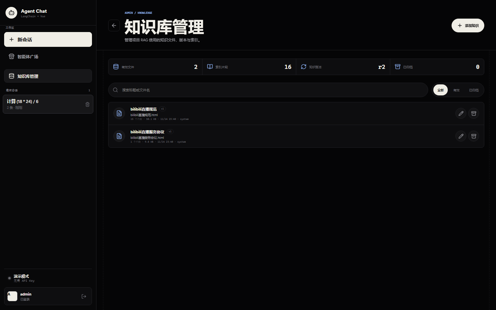
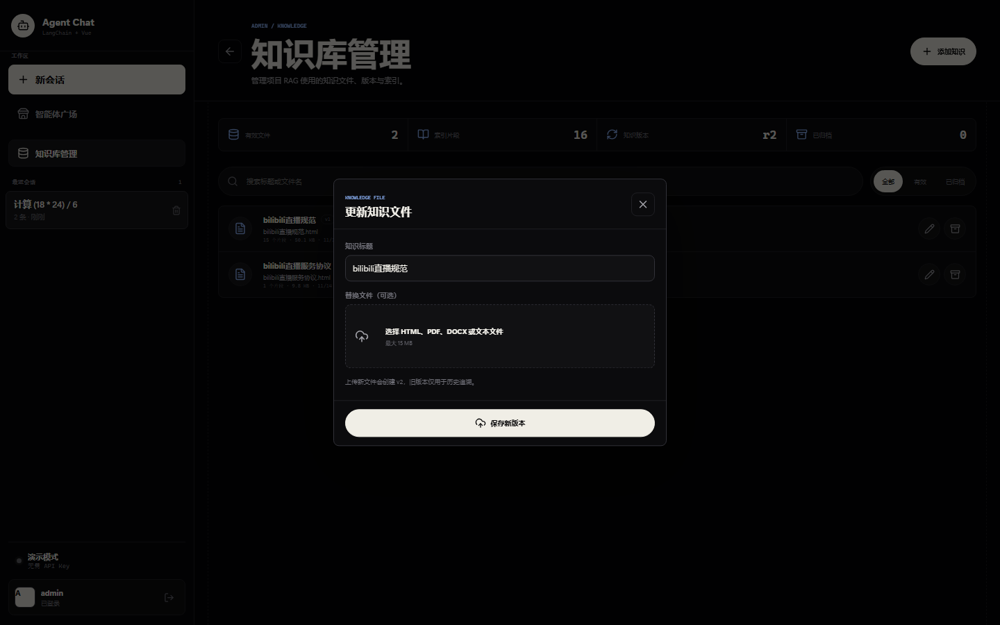
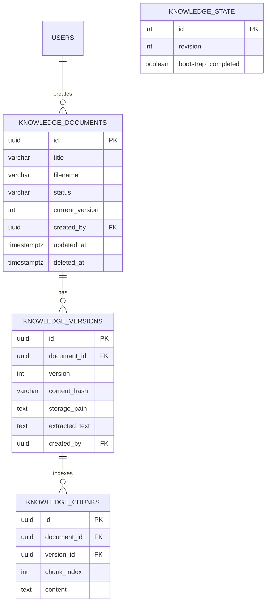
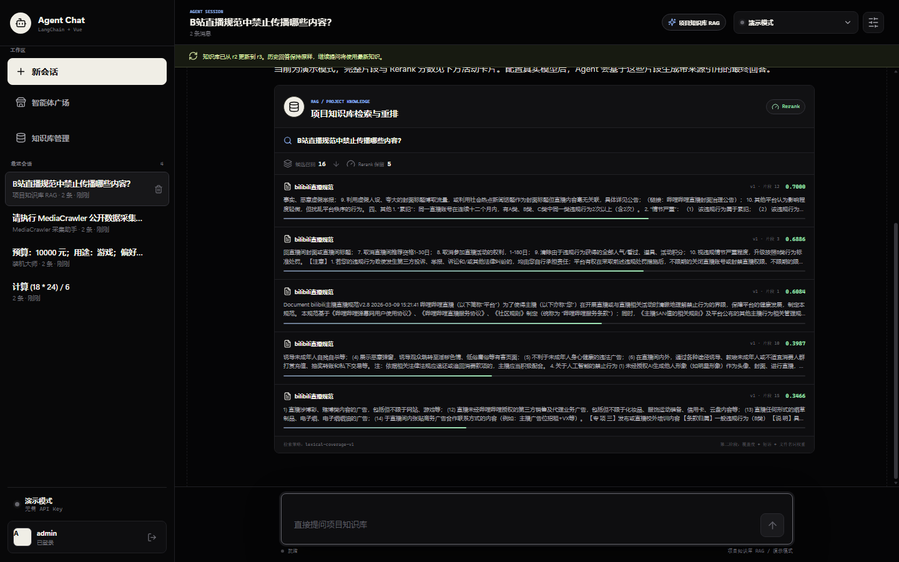

# 知识库管理与历史会话方案

## 1. 目标

在智能体广场同级增加“知识库管理”，只有管理员可见。管理员通过页面维护 RAG
知识文件，不再直接修改项目 `rag/` 目录。

核心要求：

- 管理员可新增、修改标题、替换文件、软删除知识文件。
- 普通用户不能访问管理接口或管理页面。
- 普通用户进入“项目知识库 RAG”后直接提问，无需上传文件。
- 知识文件修改后，已有会话不能出现历史回答被篡改或引用失效。





## 2. 权限模型

`users.role` 支持：

| 角色 | 权限 |
| --- | --- |
| `user` | 使用智能体、查询当前有效知识库 |
| `admin` | 普通用户权限 + 知识库增删改、版本查看、文件下载 |

管理员通过环境变量引导：

```env
ADMIN_USERNAMES=admin,ops-admin
```

- 启动时会把已存在的同名用户提升为 `admin`。
- 新注册用户如果命中管理员名单，也直接创建为 `admin`。
- 名单只负责引导提升，不会自动降级已有管理员。
- 前端仅对管理员显示“知识库管理”入口，后端仍独立执行 403 权限校验。

> 生产环境应先在对外注册开放前创建管理员账号，或通过受控部署流程管理
> `ADMIN_USERNAMES`。

## 3. 知识存储

管理员上传的文件不直接修改仓库中的 `rag/`：

```text
backend/data/knowledge/
└── {document_id}/
    ├── v1.html
    ├── v2.html
    └── v3.md
```

Docker Compose 使用 `uploads_data` 卷挂载 `/app/data`，因此
`/app/data/knowledge` 会跨容器重建保留。

项目根目录的 `rag/` 只用于首次启动迁移：

1. 如果 knowledge state 尚未完成 bootstrap，扫描 `rag/`。
2. 将支持的文件复制到 `data/knowledge`。
3. 建立版本、chunk 和初始 revision。
4. 标记 `bootstrap_completed=true`。

此后即使 `rag/` 内容改变，也不会覆盖管理员在页面中维护的知识库。

## 4. 数据模型



设计要点：

- `knowledge_versions` 永不原地覆盖。
- `knowledge_chunks` 绑定具体版本，而不是只绑定文档。
- 删除操作只把 `knowledge_documents.status` 改为 `archived`。
- 搜索只连接 `status=active` 且 `version=current_version` 的 chunk。
- `knowledge_state.revision` 在新增、编辑或归档时递增。

## 5. 管理 API

| 方法 | 路径 | 说明 |
| --- | --- | --- |
| `GET` | `/api/admin/knowledge` | 管理员文档列表与 revision |
| `POST` | `/api/admin/knowledge` | 上传新知识文件 |
| `PUT` | `/api/admin/knowledge/{id}` | 修改标题和/或上传新版本 |
| `DELETE` | `/api/admin/knowledge/{id}` | 归档文档 |
| `GET` | `/api/admin/knowledge/{id}/versions` | 查看版本历史 |
| `GET` | `/api/admin/knowledge/{id}/versions/{v}/download` | 下载历史文件 |
| `GET` | `/api/rag/status` | 所有登录用户读取有效知识状态 |

所有 `/api/admin/*` 接口要求 JWT 对应用户角色为 `admin`，否则返回 `403`。

## 6. 版本与索引流程

新增：

```text
上传文件
→ 校验类型和大小
→ 创建 document
→ 创建 version 1
→ 文本提取
→ 900 字符切块
→ 写入 knowledge_chunks
→ revision + 1
```

更新：

```text
选择新文件
→ 创建 version N+1
→ 写入新 chunk
→ document.current_version = N+1
→ revision + 1
```

归档：

```text
document.status = archived
→ revision + 1
→ 保留全部 version 与 chunk
→ 后续 RAG 搜索排除该文档
```

## 7. 老用户与历史会话处理

这是本次改造最需要谨慎处理的部分。当前策略是“历史不可变，新问题用新知识”：

### 历史回答

- 每条 RAG assistant message 的 `activity` 保存：
  - 知识库 revision
  - document ID
  - 文档标题和文件名
  - 版本号
  - content hash
  - chunk 序号
  - 片段预览和 Rerank 分数
- 管理员修改或归档文件后，消息记录不更新、不重算、不重写。
- 因此老用户看到的原回答、来源、分数和文字保持不变。

### 新提问

- 同一个旧会话继续提问时，后端重新执行检索。
- 检索只使用当前 active 文档的 current version。
- 新回答会引用最新版本并记录新的 revision。

### 用户提示

前端比较旧会话最近一次 RAG activity revision 与当前
`/api/rag/status.revision`：

- revision 相同：正常继续。
- revision 更新：显示“知识库已更新，历史回答保持原样，继续提问将使用最新知识”。



### 兼容旧版本消息

历史消息如果没有 revision 字段，会作为 legacy 消息原样保留。用户下一次提问后，
新回答会写入当前 revision；从该轮起即可正常比较版本变化。

### 归档而不是硬删除

即使管理员删除某份知识：

- 文档不再参与新 RAG 检索。
- 旧版本文件、chunk 和 hash 仍保留。
- 历史回答中的来源与版本记录仍可追溯。
- 后续可通过数据库或新增恢复 API 重新启用，而不会重建历史引用。

## 8. 前端实现

- `ConversationSidebar.vue`
  - 管理员增加“知识库管理”入口。
- `AdminKnowledgeManager.vue`
  - 文件列表、搜索、状态筛选、统计、编辑弹窗。
  - 上传新文件、修改标题、替换文件、归档。
- `App.vue`
  - 管理页与智能体广场同级切换。
  - RAG revision 变化提示。
- `RagRetrievalCard.vue`
  - 展示文档标题、文件名、版本、chunk 和 Rerank 分数。

## 9. 配置

```env
ADMIN_USERNAMES=admin,ops-admin
KNOWLEDGE_DIR=data/knowledge
PROJECT_RAG_DIR=rag
MAX_UPLOAD_BYTES=15728640
```

- `KNOWLEDGE_DIR`：管理员知识文件存储目录。
- `PROJECT_RAG_DIR`：首次启动导入源。
- `MAX_UPLOAD_BYTES`：知识文件大小上限。

## 10. 验证

自动化覆盖：

- 管理员与普通用户角色。
- 非管理员访问知识 API 返回 403。
- 管理员新增、替换版本、查看版本、归档知识。
- 启动时从 `rag/` 完成首次导入且只导入一次。
- RAG 状态、召回、Rerank 和 AG-UI 活动快照。
- 知识更新后旧回答保持不变，新回答使用新版本。

浏览器验证：

- 管理员侧栏入口与知识管理页面。
- 编辑版本弹窗。
- 项目知识库直接问答。
- 桌面与移动端布局。

## 11. 后续演进

- 增加归档恢复和回滚到指定版本。
- 增加管理员操作审计表与审批流。
- 将 `lexical-coverage-v1` 替换为向量召回 + Cross-Encoder Rerank。
- 对大文件改为后台异步索引并展示进度。
