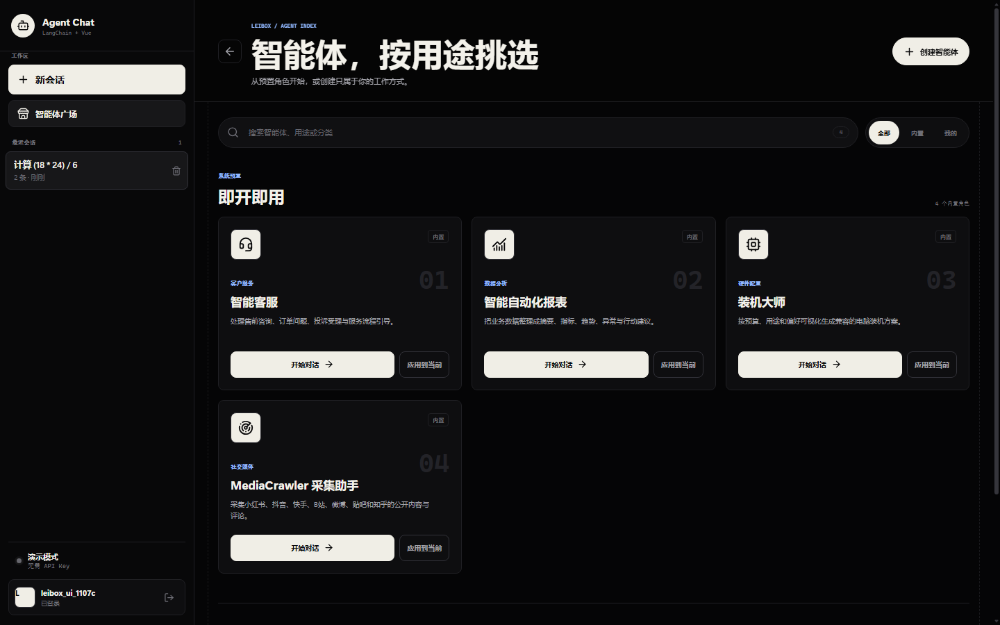
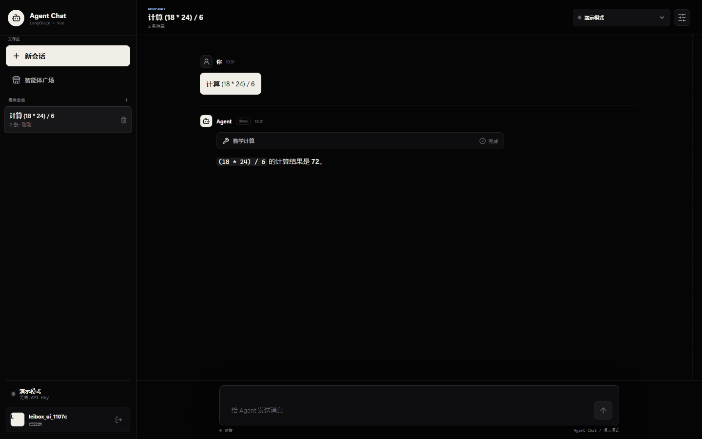
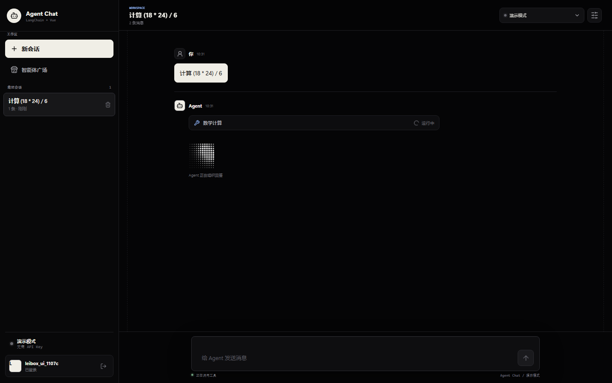
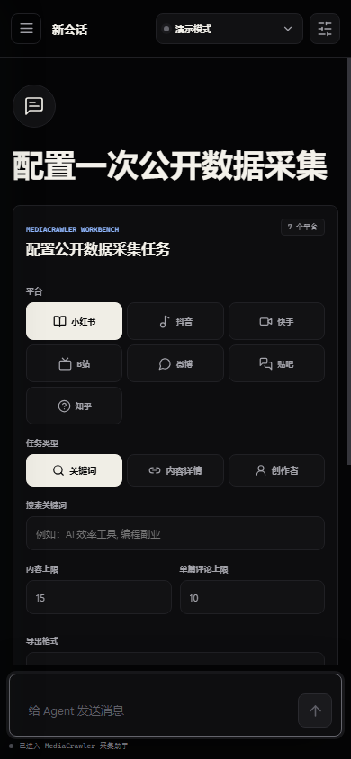

# LeiBox 风格界面

项目通过官方安装命令接入
[LeiBox Skill](https://leibox.pantoria.cn)：

```bash
npx skills add https://leibox.pantoria.cn --skill leibox
```

Skill 安装在项目目录 `.agents/skills/leibox`，版本锁定在
`skills-lock.json`。安装后，Codex 可以在后续界面开发中实时检索 LeiBox
组件目录，并按 Vue 框架拉取源码。

## 视觉系统

当前界面参考 LeiBox 目录页与组件详情页的产品语言：

- 近黑画布与细线分隔，减少装饰性容器。
- 纸白主操作按钮和胶囊式工具栏。
- 大字号标题与紧凑的等宽辅助信息。
- 磨砂顶栏、深色浮层和低对比描边。
- 目录卡片使用预览图标、分类、简介和编号建立扫描层级。
- 模型和工具运行反馈采用克制、双焦点的点阵加载动效。





## 组件取舍

LeiBox 索引中的 `Deep Agent Composer` 详情端点和源码包当前返回 404，
因此没有接入该组件。现有输入框保留业务功能，并按 LeiBox 的深色产品
语言重新设计。

`Dot Grid Loader` 的紧凑适配版本位于
`frontend/src/components/LeiBoxDotLoader.vue`。它保留源组件的双焦点点阵
逻辑，并加入 Vue 生命周期清理、系统减少动效偏好和更小的内联尺寸。



## 交互调整

- 智能体广场新增搜索与“全部 / 内置 / 我的”筛选。
- 新建智能体会话从配置器顶部开始显示，避免移动端首屏落在表单中段。
- 对话输入区增加当前智能体与服务商上下文。
- 侧栏、模型选择、活动卡片、设置面板和创建智能体抽屉统一为深色层级。


