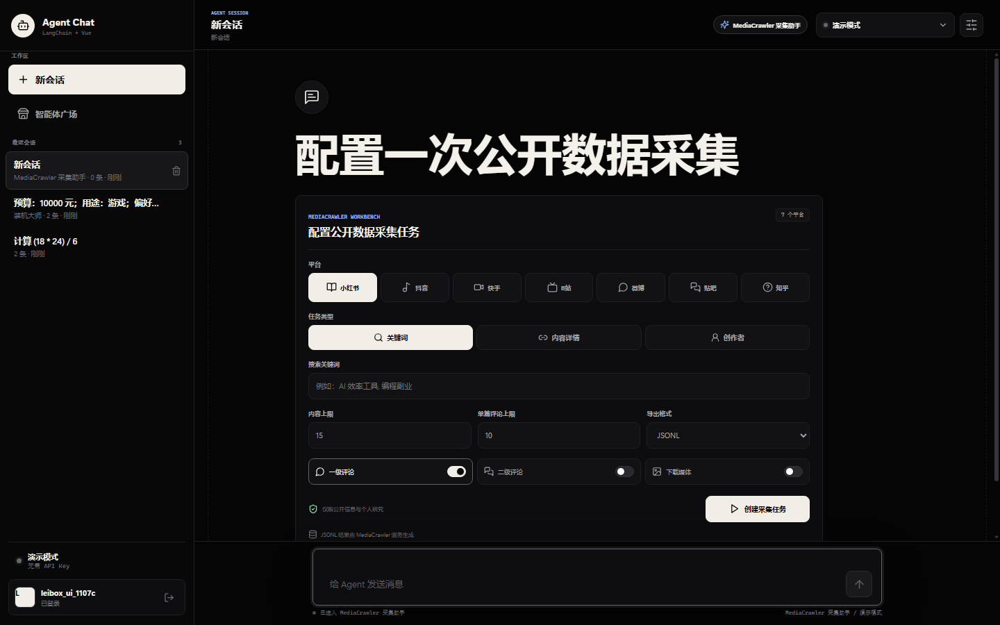
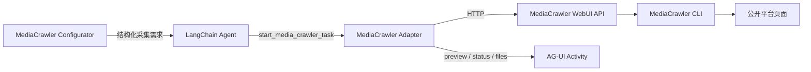
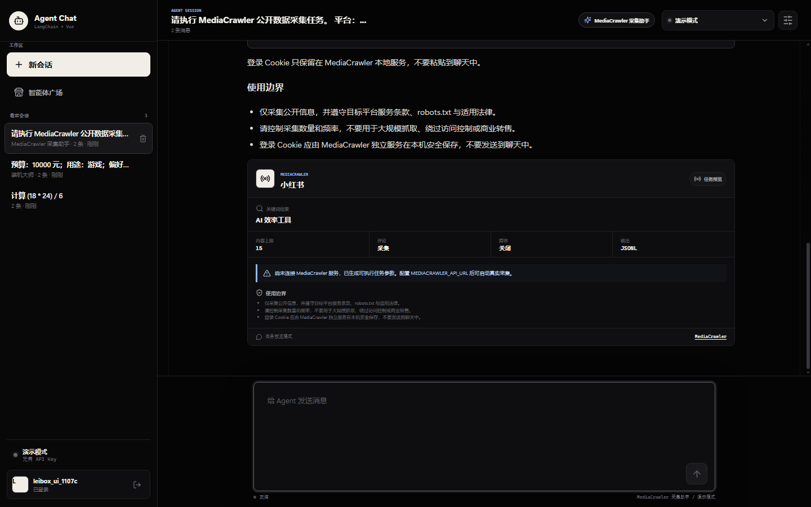
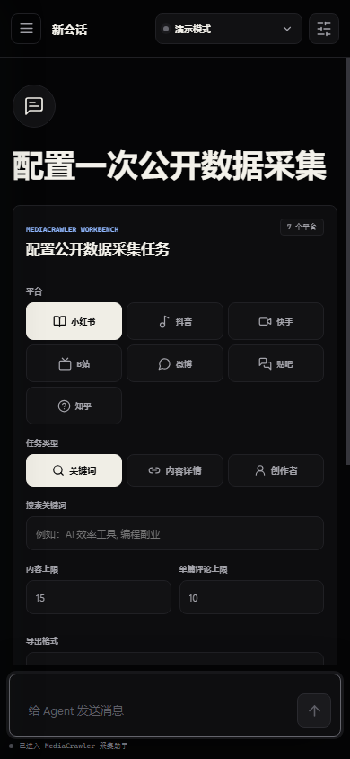

# MediaCrawler 内置智能体

本项目参考 [NanmiCoder/MediaCrawler](https://github.com/NanmiCoder/MediaCrawler)
的功能边界，在智能体广场中加入“MediaCrawler 采集助手”。应用通过 MediaCrawler
公开的 WebUI API 调用独立服务，不复制、不内嵌上游源码。



## 功能范围

- 平台：小红书、抖音、快手、B站、微博、百度贴吧、知乎。
- 任务：关键词搜索、指定内容详情、指定创作者主页。
- 数据：公开内容信息、一级评论、可选二级评论。
- 媒体：可选下载封面、图片或视频。
- 输出：JSONL、JSON、CSV、Excel、SQLite。
- 控制：内容数量、单篇评论数量、起始页与无头浏览器。

登录 Cookie 只在 MediaCrawler 独立服务的浏览器上下文中使用，不进入 Agent Chat
消息、数据库或模型上下文。

## 架构



Agent Chat 不直接执行 Playwright 或拼接平台签名参数。这样可以把浏览器登录态、
代理、Node.js 运行时和平台适配留在 MediaCrawler 服务中，Agent Chat 只负责对话、
参数校验、活动事件与结果说明。

## 配置

先从 MediaCrawler 仓库启动 WebUI API：

```bash
uv run uvicorn api.main:app --host 127.0.0.1 --port 8080
```

再配置 Agent Chat：

```env
MEDIACRAWLER_API_URL=http://127.0.0.1:8080
MEDIACRAWLER_API_TOKEN=
```

`MEDIACRAWLER_API_URL` 可以填写服务根地址，也可以带 `/api` 后缀。可选
`MEDIACRAWLER_API_TOKEN` 会作为 Bearer Token 发送。

Docker 部署时，`127.0.0.1` 指向 Agent Chat 后端容器自身。需要把 MediaCrawler
部署到同一网络，并使用服务名地址，例如 `http://mediacrawler:8080`。

## 任务闭环

1. 前端配置器生成可读的采集任务说明。
2. LangChain 模型调用 `start_media_crawler_task`，或在演示模式下由确定性解析器
   直接调用同一工具。
3. 未配置服务时返回 `preview`，明确标记“任务预览”，不伪造数据。
4. 已配置服务时调用 `/api/crawler/start`，返回 `accepted` 或 `busy`。
5. `get_media_crawler_status` 读取 `/api/crawler/status` 与日志。
6. `list_media_crawler_files` 读取 `/api/data/files`。
7. 工具结果通过 `ACTIVITY_SNAPSHOT` 持久化到消息的 `activity` 字段。





## 安全与合规

- 仅用于公开信息、学习研究和获得授权的数据采集。
- 默认内容上限 100、单篇评论上限 100，不提供无限抓取入口。
- 不接收聊天中的 Cookie，不提供验证码绕过、风控绕过或访问控制绕过能力。
- 不把预演参数描述成真实采集结果。
- 使用者需要自行遵守目标平台服务条款、robots.txt、著作权与个人信息保护要求。
- MediaCrawler 上游采用非商业学习许可；商业使用需单独评估授权。

## 测试

后端测试覆盖：

- 内置智能体种子包含 MediaCrawler。
- 工具只对 MediaCrawler 智能体开放。
- 未配置服务时返回可执行任务预览。
- 外部 API 地址规范化与 Bearer Token 传递。
- 搜索、详情与评论参数映射。
- AG-UI `media-crawler-task` 活动事件持久化。
